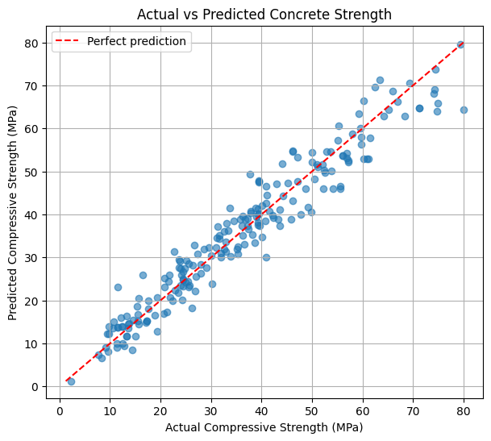
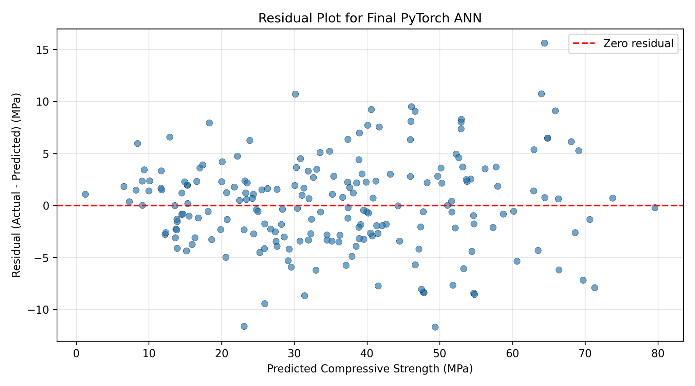
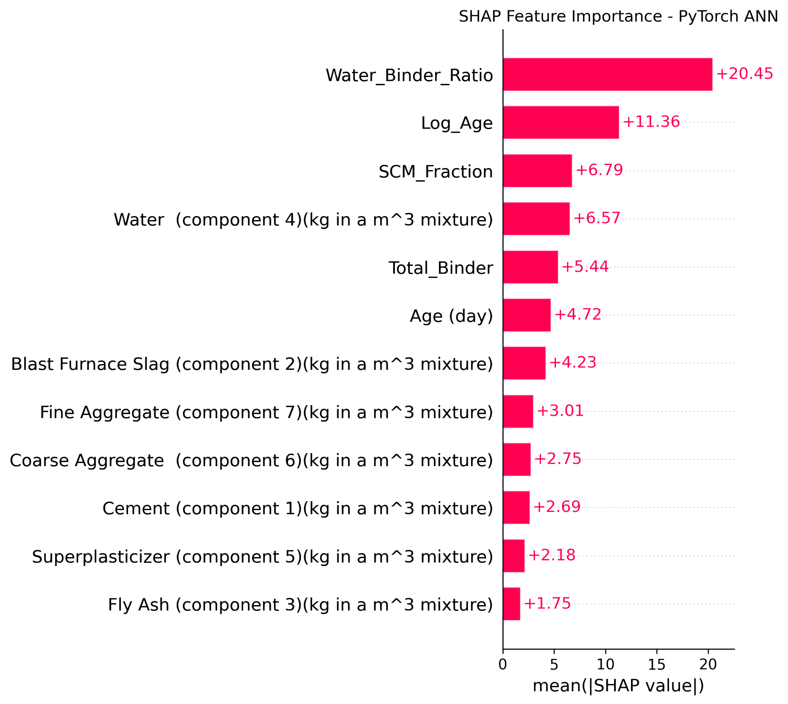
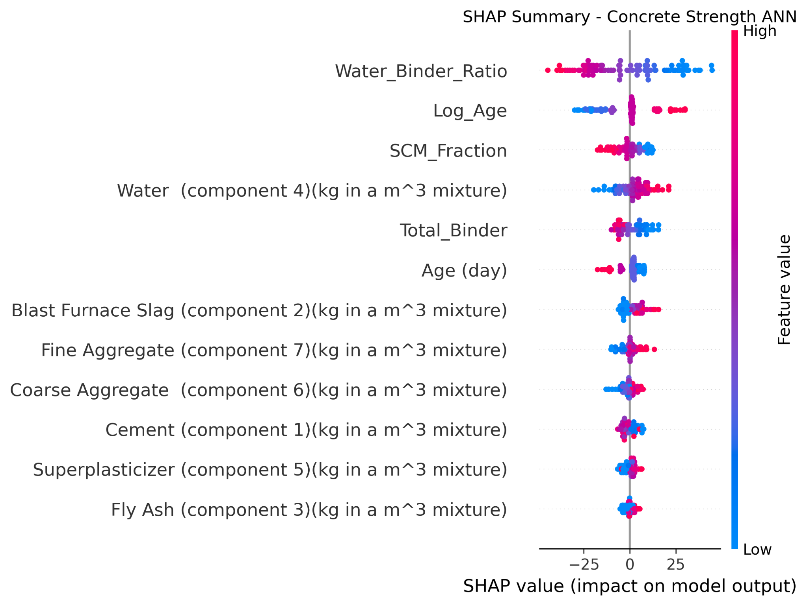

# 🏗️ Concrete Compressive Strength Prediction with PyTorch

**Artificial neural network regression · structural/materials engineering · model interpretation**

This project develops a feedforward neural network to estimate the compressive strength of concrete (MPa) from mixture composition and curing age. The workflow demonstrates engineering-informed feature design, careful model evaluation, hyperparameter tuning, residual diagnostics and SHAP explanations.

## Results

| Experiment | Mean 5-fold CV RMSE (MPa) |
|---|---:|
| Baseline ANN (8 inputs, 32–16) | 10.117 |
| + Engineering-informed features (12 inputs) | 6.503 |
| + Learning-rate tuning (0.003) | 5.849 |
| + Architecture tuning (128–64) | 5.194 |
| + Weight decay (0.0001) | **5.116** |

**Final model:** 12 features → 128 → 64 → 1 output; ReLU hidden activation; Adam optimizer; learning rate `0.003`; weight decay `0.0001`; 1,000 epochs.

| Evaluation | RMSE (MPa) |
|---|---:|
| Final training | 3.923 |
| Mean group-aware 5-fold CV | 5.116 |
| Supplied test set (206 samples) | **4.418** |
| Test mixtures absent from training inputs (196 samples) | **4.390** |

*These are observed results from the original experiment. The data include 10 test rows with input combinations also found in training; the unseen-mixture RMSE is provided as a sensitivity check. The selected CV estimate may be optimistic because multiple hyperparameters were compared on the same folds. Results can differ across library versions.*

## Figures

### Predicted vs observed strength


### Residual diagnostics


### SHAP feature importance


### SHAP beeswarm


The model attributes large contributions to water-to-binder ratio and curing age transformations. These attribution values describe the fitted model; they are **not causal estimates** and require caution because engineered features are correlated.

## Reproduce the analysis

1. Download or clone the repository.
2. Install Python dependencies: `pip install -r requirements.txt`.
3. Start Jupyter: `jupyter lab` or `jupyter notebook`.
4. Open [`notebooks/concrete_strength_ann_pytorch.ipynb`](notebooks/concrete_strength_ann_pytorch.ipynb) and run the cells in order.

The notebook loads `data/train-val.csv` and `data/test.csv` from the repository (or when run inside `notebooks/`, from `../data/`). In Google Colab, upload those CSVs into a `data/` folder or clone the repository before running. The multiple 5-fold experiments require nontrivial CPU time.

## Project structure

```text
concrete-strength-ann-pytorch/
├── README.md
├── requirements.txt
├── .gitignore
├── data/
│   ├── README.md
│   ├── train-val.csv
│   └── test.csv
├── notebooks/
│   └── concrete_strength_ann_pytorch.ipynb
└── figures/
    ├── baseline_learning_curves.png
    ├── feature_engineering_comparison.png
    ├── early_stopping_curve.png
    ├── actual_vs_predicted.png
    ├── residual_plot.png
    ├── shap_feature_importance.png
    ├── shap_beeswarm.png
    └── shap_waterfall.png
```

## Methods

- Data: eight original numerical inputs and compressive strength target; exact duplicates removed from training set.
- Features: total binder, water-to-binder ratio, SCM fraction and `log1p(age)`.
- Preprocessing: `StandardScaler` fitted within each training fold to avoid validation leakage.
- Validation: `GroupKFold` to keep identical input combinations in the same fold.
- Optimizer, activation, loss: PyTorch Adam, ReLU, and mean squared error (MSE), evaluated with RMSE in MPa.
- Interpretation: residual plots and `shap.DeepExplainer` using a training background sample and previously unseen test mixtures.

## Dataset and attribution

The original concrete dataset is from the UCI Machine Learning Repository, licensed **CC BY 4.0**:

> Yeh, I. (1998). *Concrete Compressive Strength* [Dataset]. UCI Machine Learning Repository. https://doi.org/10.24432/C5PK67

The underlying research was described in Yeh, I.-C. (1998). Modeling of strength of high-performance concrete using artificial neural networks. *Cement and Concrete Research, 28*(12), 1797–1808.

## Scope

This project is an educational regression experiment. Predictions are not a substitute for laboratory concrete testing, code checks, or engineering judgement.

### Related work

Earlier conventional machine-learning work on concrete strength: [Predicting Concrete Compressive Strength (ML)](https://github.com/Uche-creator-debug/predicting_concrete_compressive_strength_ml). This is a **separate** PyTorch neural-network experiment; reported scores should not be directly compared across different dataset splits.
